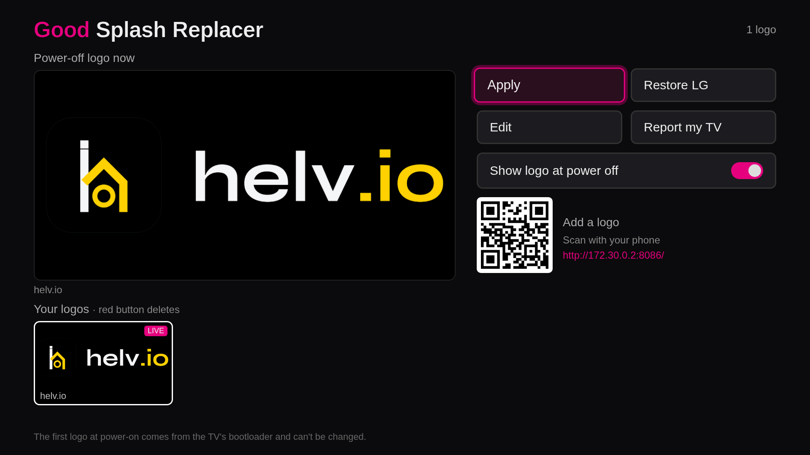
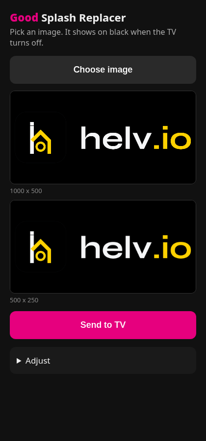
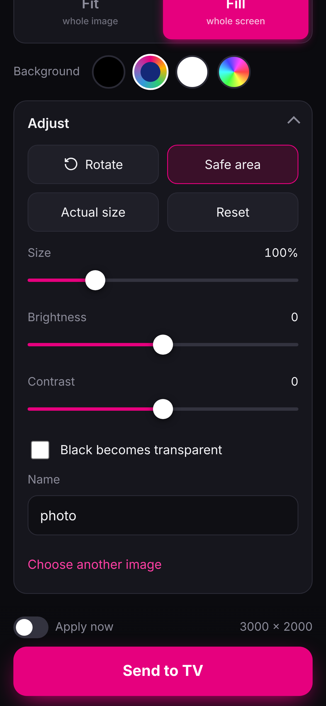
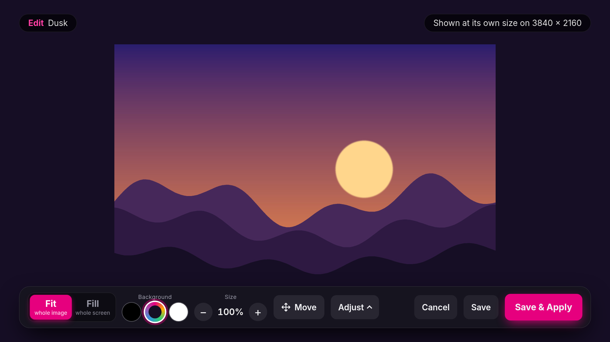
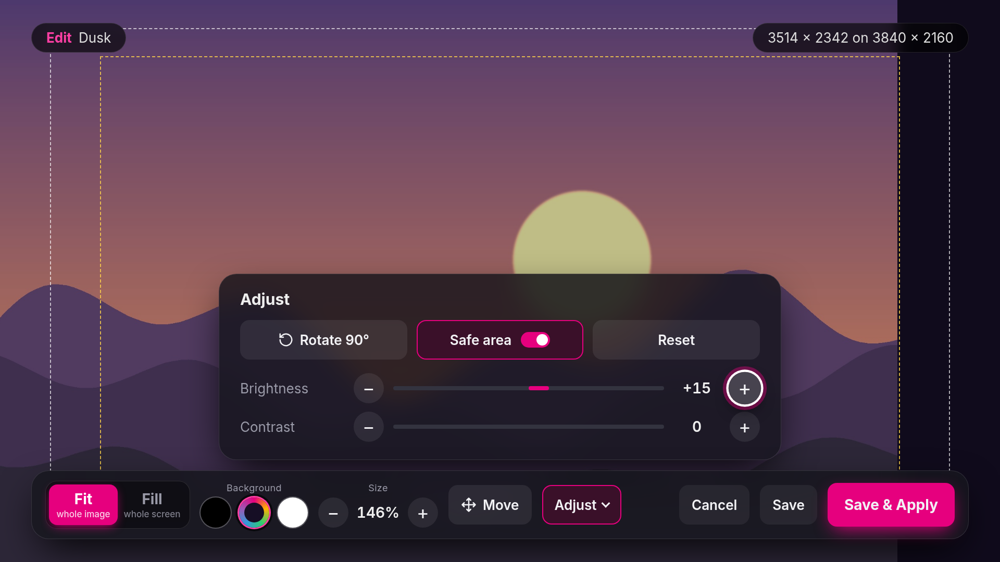
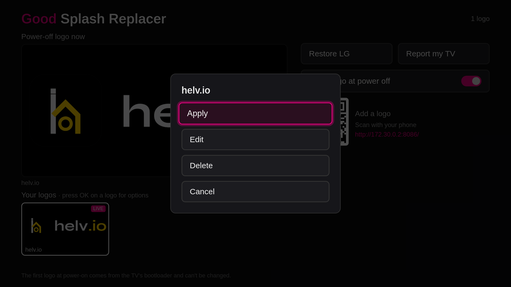

# Good Splash Replacer

Replace the LG logo on the power-off screen of a rooted LG webOS TV with your own image. Good, as in Life's Good.



## Features

- Send a logo from your phone: scan the code on the TV, pick an image, press Send. The TV-shaped preview is drawn by the same code the TV uses, so it shows exactly what the TV will show.
- Phone editor: Fit or Fill in one tap, pinch to size, drag to move with snapping to center, double tap to reset. Background black, matched to the image edge, white or any color. Adjust holds rotate, brightness, contrast, a safe area guide and an actual size view.
- Apply now: the TV opens the logo's menu so the person at the TV confirms.
- Works with a basic remote, arrows, OK and Back only, and with the Magic Remote pointer: point to focus, click to choose, click outside a menu to close it, scroll the logos with the wheel. Press OK on a logo for Apply, Edit or Delete; Delete asks first.
- Restore LG, and a switch to hide the power-off logo.
- TV editor: a full-screen preview of the power-off screen with a dock made for the remote. Fit or Fill, background black, matched to the image edge or white, size, and Move, where the arrows move the image until you press OK. Adjust holds rotate, brightness, contrast, a safe area guide and reset. Save, or Save & Apply. Back closes Adjust first and asks before dropping edits.
- Report my TV: read-only details about how your TV draws the logo, sent as a GitHub issue in one scan.

| Phone | Phone, Adjust |
| --- | --- |
|  |  |

| TV editor | TV editor, Adjust |
| --- | --- |
|  |  |



## Requirements

- A rooted LG webOS TV with the [Homebrew Channel](https://github.com/webosbrew/webos-homebrew-channel).
- Root is required: the logo is replaced with bind mounts.

## Install

From a [release](https://github.com/helv-io/good-splash-replacer/releases), install `io.helv.goodsplash_<version>_all.ipk` with the Homebrew Channel, `ares-install`, or as root on the TV:

```sh
scp io.helv.goodsplash_<version>_all.ipk root@TV:/tmp/
ssh root@TV 'luna-send -n 1 luna://com.webos.appInstallService/dev/install "{\"id\":\"io.helv.goodsplash\",\"ipkUrl\":\"/tmp/io.helv.goodsplash_<version>_all.ipk\",\"subscribe\":true}"'
```

To keep the logo after a reboot, copy both startup scripts to `/var/lib/webosbrew/init.d/`: `init.d/73-goodsplash` starts the service and `init.d/72-goodsplash-logo` re-applies the logo.

## How it works

- The power-off screen is the `com.webos.app.masterbrand` QML app. The service reads `MasterBrand.qml`, finds the logo files it uses, such as `LG_logo_4k.png` and `LG_logo_2k.png`, and the screen each one is shown on. The logo is drawn centered on a full-screen window at its own pixel size, so every logo is rendered once per file at the full screen size, such as 3840 x 2160 and 1920 x 1080. If the screen cannot be read, the stock logo size is used.
- Apply writes new files to `/mnt/lg/user/custom-logo/masterbrand/` and bind-mounts each one over its stock file: one unmount, one mount, never stacked, and a mounted file is never written. Restore LG unmounts them and deletes the copies.
- The switch maps to the TV's own `lgLogoDisplay` setting.
- The service runs as root on port 8086, set in `service/config.json`. It accepts connections from the local network only. Phones can send logos; apply, restore, delete and the switch work from the TV only.

## Safety

- Nothing is written to flash or to any partition. The stock files are never modified.
- Restore LG undoes everything; so does a reboot without the startup scripts.
- To uninstall: press Restore LG, delete `72-goodsplash-logo` and `73-goodsplash` from `/var/lib/webosbrew/init.d/`, then remove the app.
- The report reads the first 64 bytes of the logo partition, read only.

## The first logo cannot change

The first logo at power-on comes from the TV's bootloader, which reads it from its own partition before webOS starts. This app does not touch it.

## Supported TVs

| Model | Firmware | Chip | Power-off logo |
| --- | --- | --- | --- |
| 86UA9000AUC | 33.31.75 | Realtek K24N | works |

Another TV? Open Report my TV, scan the code, and send the issue. It has no serial numbers, MAC or IP addresses.

## Development

```sh
tools/chk.sh                 # syntax, unit tests, ipk build: the same as CI
tools/release 0.2.1          # bump, check, commit and tag
```

See [AGENT.md](AGENT.md) for the rules. MIT license; third-party notices in [THIRD_PARTY_NOTICES.md](THIRD_PARTY_NOTICES.md).
